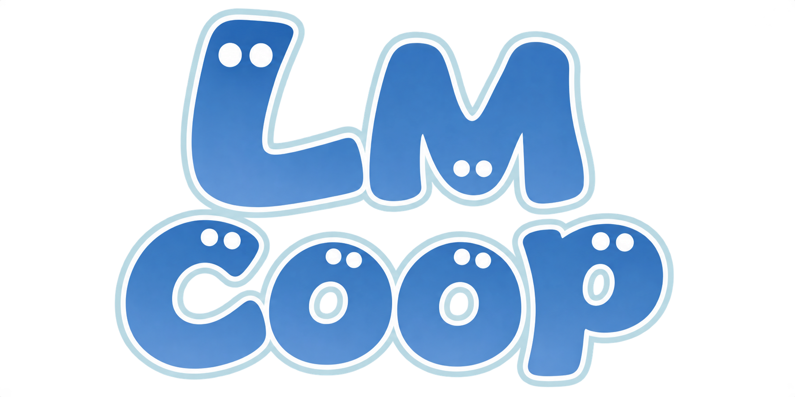

<p align="center">
  
</p>

A native Windows recompilation of Luigi's Mansion with a Singleplayer / Multiplayer start menu and experimental online co-op.

Based on [rob646464/luigis-mansion-recompiled](https://github.com/rob646464/luigis-mansion-recompiled). This is an independent project by [Recoi1](https://github.com/Recoi1).

**No disc images, extracted game data, saves, or generated game modules are included.** You must supply your own USA disc dump (GLME01 revision 0). Setup builds the game module locally with the bundled compiler.

## Download and play

1. Open [Releases](https://github.com/Recoi1/LmCoop/releases/latest) and download the Windows x64 ZIP.
2. Extract the entire ZIP to a writable folder on Windows 10 or 11 with a Direct3D 12 capable GPU.
3. Run `LuigisMansionRecomp.exe`. Keep the DLLs and `llvm` folder beside it.
4. Drag your USA disc image onto the setup screen, or use Browse. Allow the game module and shaders to build.
5. Choose **Singleplayer** or **Multiplayer**.

ISO and RVZ disc images are supported. The LmCoop setup screen accepts the USA game; inherited documentation about selecting a European disc does not describe this screen.

## Online co-op

Both players need this same build and their own USA game dump. On the Multiplayer screen, one player chooses **Host (play as Luigi)** and the other **Join (play as Mario)**. Use the host's reachable address, matching port and password. For internet play, the current UI recommends putting both PCs in the same Radmin VPN network and using the host's VPN address.

The host chooses a save and enters the game. The joining player sees a loading screen and
automatically enters the host's current room as Mario, without selecting a local save.
The loading screen remains while the host is in menus or changing maps. Player 2's own
saves are read-only during the session. Both PCs must update together to version 1.2.0
or newer; older online builds cannot join this protocol.

Online co-op is experimental. Full campaign completion and reliable synchronization across separate PCs have not been verified for this release. The underlying two-player mode also has unfinished areas.

## Controls and data

F1 opens settings. Keyboard, mouse, and controller bindings are available under Controls. Mouse selection is supported on the file selection screen.

The start screen also has a **Settings** menu for visuals, sound, and controls. The version
and automatic update status appear in the bottom-right corner. Click that status to see
release notes and download/install an update before playing.

Settings, caches and saves use `%APPDATA%\Luigi's Mansion Recompiled` by default. Create `portable.txt` next to the executable before first launch to use a local `portable` folder instead. Back up existing saves before trying experimental multiplayer. Diagnostic output is in `last_run.log` in the data folder.

To uninstall, delete the extracted release folder. Data in AppData remains; remove it separately only if you no longer want the settings and saves.

## Build from source

Clone this repository with its submodule:

```powershell
git clone --recurse-submodules https://github.com/Recoi1/LmCoop.git
cd LmCoop
.\tools\build.ps1 -Configure -Target LuigisMansionRecomp
```

Requires Visual Studio 2022 C++ build tools, LLVM clang/lld, CMake 3.25+ and Ninja on PATH. No game dump is needed to build the distributable setup/runtime target. The `lmrecomp` developer target embeds translated game code and must remain private. See [setup architecture](docs/SETUP.md) for the inherited technical design; release links in older design documents refer to the original project.

## Credits and licensing

- Original recompilation/runtime: [rob646464/luigis-mansion-recompiled](https://github.com/rob646464/luigis-mansion-recompiled).
- Decompilation reference: [SomeJakeGuy/lm-decomp](https://github.com/SomeJakeGuy/lm-decomp), CC0; see `decomp/LICENSE`.
- Aurora: [encounter/aurora](https://github.com/encounter/aurora), MIT; see `extern/aurora/LICENSE` and the local patch series.
- Other third-party notices are in [NOTICE.md](NOTICE.md). Bundled LLVM uses Apache-2.0 WITH LLVM-exception; its license is included in the download.
- This project includes AI-assisted development. Codex prepared this GitHub publication; prior AI-assisted work is recorded in the commit history. Do not submit AI-assisted code to lm-decomp.

Luigi's Mansion and its characters belong to Nintendo. This project is not affiliated with or endorsed by Nintendo. No new blanket license is applied to third-party code; retain the existing component licenses and notices.
